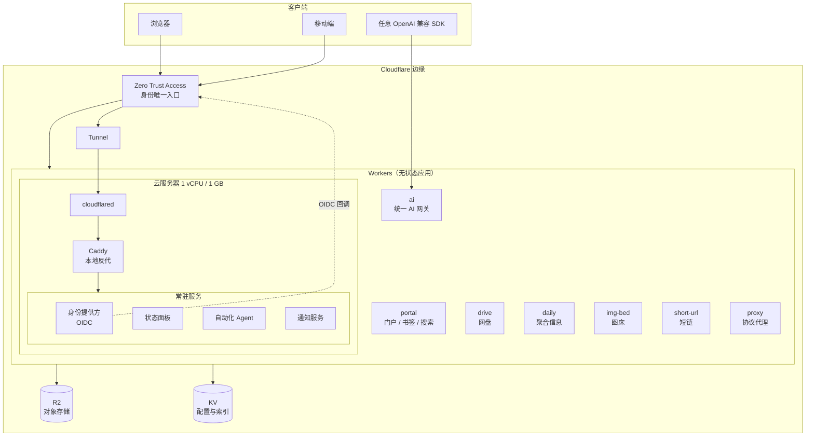

# 自托管个人云平台

一套完全跑在免费额度内的个人基础设施：Cloudflare 边缘计算承担无状态应用，一台 1 GB 内存的云服务器承担有状态服务，两者通过隧道互联，身份统一收敛到一个零信任入口。

> **这是一个用于展示架构与实现思路的公开镜像。** 仓库内不含任何真实密钥、账号 ID、资源标识或生产数据。所有配置项均以占位符形式给出，克隆后填入自己的值即可运行。

**English summary** — A self-hosted personal cloud built entirely on free tiers: stateless apps on Cloudflare Workers, stateful services on a single 1 GB VM behind a Cloudflare Tunnel, with one Zero Trust entry point for all identities. This repository documents the architecture and ships a static demo of the console UI. No production secrets or identifiers are included.

---

## 一、为什么做这个

个人服务的常见做法是「买台 VPS，装宝塔，什么往上堆」。这套方案在成本和可维护性上都不划算：

- 一台小机器同时承担反向代理、数据库、对象存储、定时任务，内存永远是瓶颈；
- 所有服务暴露在公网，靠每套应用各写一套登录逻辑；
- 备份、扩容、迁移都是手工活。

这套平台换了个分工：

| 层 | 承担什么 | 为什么 |
|---|---|---|
| 边缘（Cloudflare Workers） | 所有无状态、请求-响应型应用 | 免费额度足够个人用量，冷启动可忽略，天然全球分发 |
| 服务器（1 vCPU / 1 GB） | 有状态、常驻进程 | 需要文件系统、需要长连接、需要跑容器 |
| 隧道（Cloudflare Tunnel） | 服务器对外暴露 | 不开放任何入站端口，服务器不需要公网 IP |
| 身份（Zero Trust Access） | 所有入口鉴权 | 应用层不再各写登录，鉴权下沉到网络层 |

结果：**零公网入站端口、零应用层密码、单机内存占用稳定在 700 MB 以下**，月成本为零。

---

## 二、架构总览



**三条控制流值得单独说明：**

1. **鉴权流**：外部请求先过 Access（未认证直接 302 到登录页），通过后由 Access 注入 JWT，Worker 侧二次校验 JWT 的 `aud` 与签名。应用本身不知道密码是什么。
2. **AI 流**：所有模型调用收敛到单一 Worker，客户端只持有平台签发的 Key，上游密钥永不出边缘。
3. **运维流**：本地不保存 SSH 私钥，所有服务器操作走云厂商的 Session Manager，命令与输出全部留痕。

---

## 三、组件清单

### 边缘侧（无状态）

| 组件 | 职责 | 关键设计 |
|---|---|---|
| `portal` | 导航、书签、全局搜索、命令面板 | 单页应用，配置存 KV，冷启动 < 50 ms |
| `ai` | OpenAI 兼容网关、多上游路由、Key 管理、限流、后台 | 上游注册表与业务逻辑分离；管理面独立鉴权（密码 + TOTP） |
| `drive` | 文件列表、分片上传、分享链接、配额 | 元数据进 KV，实体进 R2；分片大小按 Cloudflare 请求体上限反推 |
| `daily` | 天气、日历、节假日、聚合资讯 | 定时触发 + KV 缓存，缓存键按日期切片 |
| `img-bed` | 图片上传与分发 | Token 鉴权，直传 R2，回源走 Worker |
| `short-url` | 短链创建与跳转 | KV 前缀索引，跳转路径不打日志 |
| `vmail` | 域名邮箱收件箱 | 邮件路由 → Worker 解析 → KV 存储 |
| `proxy` | 容器镜像与特定协议代理 | 白名单域名，不做通用转发 |

### 服务器侧（有状态）

| 组件 | 职责 | 资源占用 |
|---|---|---|
| `cloudflared` | 隧道出口，唯一对外通道 | ~30 MB |
| `Caddy` | 本地反向代理、内部 TLS | ~25 MB |
| 身份提供方 | OIDC IdP，为 Access 提供身份源 | ~120 MB |
| 状态面板 | 服务健康与聚合信息 | ~40 MB |
| 自动化 Agent | 长驻任务、消息桥接 | ~90 MB |
| 通知服务 | 移动端推送 | ~20 MB |

> 1 GB 内存跑这些的代价是必须配 2 GB swap，且要盯着 swap 使用率——这是本方案最脆弱的环节，后文「已知限制」有说明。

### 可观测

- 云厂商侧：6 条告警（实例状态、CPU、CPU 积分余额、内存、swap、磁盘），经消息队列 → 函数计算 → 群机器人推送。
- 应用侧：Worker 自带指标 + 边缘日志；服务器侧容器日志集中到一个轻量查看器。

---

## 四、关键技术决策

### 4.1 为什么把单体拆成八个 Worker

最初是一个 4,652 行、218 KB 的单文件 Worker，什么都在里面。问题不是性能，是**改动风险**：改短链的一行代码，网盘和 AI 一起重新部署。

拆分原则是「一个 Worker 只做一件事」，但拆分本身有代价——Workers 之间不能共享模块，公共逻辑只能复制或走 Service Binding。

最终选择：**公共逻辑内联复制，不引入 Service Binding**。理由是这份公共代码（JWT 校验、响应封装）不到 200 行且极少变动，而 Service Binding 会引入额外的调用链和故障点。这是「重复优于抽象」的一次刻意选择。

拆分收益（实测）：单文件最大行数从 4,652 降到 864，降幅 81%；任一组件可独立回滚。

### 4.2 为什么 AI 入口必须唯一

改造前存在三套并存的 AI 调用路径：一体化门户里硬编码的、独立透传 Worker 的、服务器侧反向代理的。后果是密钥散落在三个地方，没有任何一处能统计用量或限流。

统一后的结构：

```
客户端 → [Bearer Key] → ai Worker → 上游注册表 → 模型供应商
                          ├── Key 校验与配额
                          ├── 上游密钥注入（客户端不可见）
                          ├── 失败切换
                          └── 用量记账
```

关键点是**上游密钥只在 Worker 内存中存在**，通过 Secret 注入，客户端拿到的 Key 与上游完全解耦。这样吊销一个客户端不影响其他人，轮换上游密钥不需要通知任何使用者。

### 4.3 为什么不用自建登录

自建登录的三个隐性成本：密码找回流程、会话管理、以及「每个应用都要重新实现一遍」。

改成「网络层鉴权 + 应用层信任 JWT」后，应用代码里没有一行登录逻辑。代价是：**无法做细粒度的应用内权限**（比如「A 用户只能看网盘的某个目录」）。对单用户场景这是净收益；对多租户场景这个架构不成立。

### 4.4 服务器为什么不上公网 IP

关闭全部入站端口，只保留出站。这条约束带来三个好处：不需要处理证书续期（隧道终结 TLS）、不需要防扫描、迁移时不用改 DNS。

代价是排障变麻烦：无法从外网直接 ping 或 SSH。补偿手段是 Session Manager（走云厂商控制面）和一个只读的探针 Token。

---

## 五、目录结构

```
.
├── docs/
│   ├── architecture.md      # 分层设计与数据流
│   ├── ai-gateway.md        # AI 网关的完整设计
│   ├── security.md          # 零信任配置与威胁模型
│   ├── operations.md        # 部署、回滚、备份
│   └── lessons.md           # 踩过的坑与复盘
├── site/                    # 控制台 UI 的静态演示（纯前端 mock）
├── examples/
│   ├── worker-skeleton.js   # 单文件 Worker 的最小骨架
│   ├── wrangler.toml.example
│   └── compose.example.yml
└── README.md
```

---

## 六、快速开始

以下流程使用占位符，替换为你自己的值。

```bash
# 1. 克隆
git clone <repo-url> && cd <repo>

# 2. 配置边缘侧
cp examples/wrangler.toml.example wrangler.toml
# 填入你的 account_id、KV namespace id、R2 bucket 名

# 3. 注入密钥（只写不可读）
npx wrangler secret put UPSTREAM_KEY
npx wrangler secret put ADMIN_PASSWORD
npx wrangler secret put CONFIG_ENC_KEY   # openssl rand -hex 32

# 4. 部署
npx wrangler deploy

# 5. 服务器侧
cp examples/compose.example.yml compose.yml
cp .env.example .env && chmod 600 .env
docker compose up -d
```

### 密钥管理约定

| 约定 | 说明 |
|---|---|
| 密钥只通过 Secret 注入 | 不写进 `wrangler.toml`，不写进代码 |
| 本地 `.env` 权限 600 | 且必须在 `.gitignore` 内 |
| 提交前扫描 | `grep -rE "(token|secret|password|AKIA)" --include="*.js" --include="*.toml"` |
| 定期轮换 | 上游密钥、云厂商 Access Key、隧道 Token 分开轮换 |

---

## 七、已知限制

这套架构有几个明确的边界，不掩饰：

1. **1 GB 内存是硬约束**。所有常驻服务加起来逼近上限，靠 swap 兜底。swap 使用率超过 70% 时响应会明显劣化。想加服务必须先砍服务。
2. **KV 最终一致**。网盘的目录列表在跨区域写入后有秒级延迟，不适合做需要强一致的场景。
3. **Worker 请求体上限**。大文件上传必须分片，分片逻辑因此变复杂。
4. **单点**。服务器只有一台，挂了就是全挂。没有做高可用——个人场景下这个投入产出比不合理，接受停机。
5. **服务商的免费额度是前提**。超出额度后成本曲线会突然变陡，这套设计不做成本兜底。

---

## 八、免责与许可

本项目为个人基础设施的架构记录，代码与文档按现状提供，不构成任何可用性承诺。

文档与示例代码采用 [MIT License](LICENSE)。架构思路可自由参考，但不建议直接照搬用于生产环境——尤其是单机单点与免费额度依赖这两点。

---

## 附：演示站

在线版本：**<https://p1.mccmx1.cc.cd/>**

`site/` 目录是控制台 UI 的静态演示，全部数据为前端硬编码的假数据，不连接任何后端、不发起任何网络请求。也可以直接本地打开：

```bash
cd site && python -m http.server 8080
```
